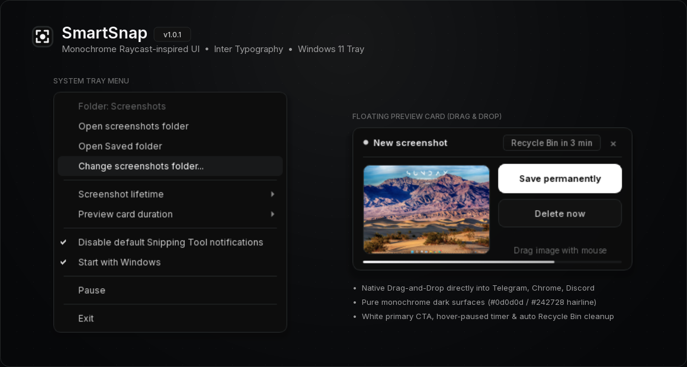
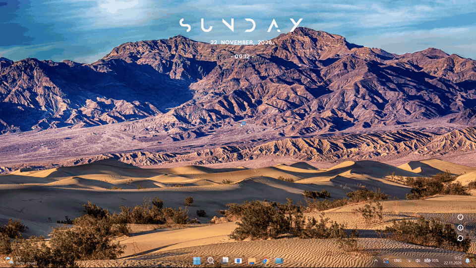

# SmartSnap

**Lightweight Windows 11 background utility for effortless temporary screenshot management**  
**Легка фонова утиліта для Windows 11, яка наводить лад у тимчасових скріншотах**

-0078D4?style=for-the-badge&logo=windows11&logoColor=white)

-0EA5E9?style=for-the-badge)

[**English**](#-english) • [**Українська**](#-українська) • [**Download v1.0.1**](../../releases/latest)

 

🎬 Watch Drag-and-Drop workflow in action (GIF)

 

---

## 🇬🇧 English

**SmartSnap** lives quietly in your Windows 11 system tray and turns `Win + Shift + S` into a fast, clutter-free workflow. Whenever you capture a screenshot, a sleek monochrome dark preview card smoothly appears in the bottom-right corner — drag it straight into any app, save it permanently, delete it immediately, or let SmartSnap automatically clean it up to the Recycle Bin.

### 🆕 What's New in v1.0.1
- **Monochrome Raycast-Inspired Redesign** — Deep `#0d0d0d` dark surfaces, crisp `1px` `#242728` hairline borders, high-contrast white primary CTA, keycap TTL chip, and matching dark tray menu.
- **Bundled Inter Typography** — Built-in **Inter** font (with full Latin & Cyrillic support) for crisp, native-feeling readability on Windows 11.
- **Refreshed Monochrome Tray & App Icon** — Blends seamlessly into the Windows 11 system tray alongside system icons.

### ✨ Key Features

- **Native Drag-and-Drop Preview Card** — Compact monochrome dark card (`344×176 px`, frameless, always on top without stealing focus). Grab the thumbnail with your mouse and drag it straight into **Telegram, Chrome/Edge, Discord, Slack, Explorer**, or any other app.
- **Hover & Drag Timer Pause** — A thin smooth progress bar counts down card visibility (`3`, `5`, or `10` seconds) and automatically pauses while your cursor hovers over the card or while you are dragging the screenshot.
- **Automatic Temporary Cleanup** — Screenshots you don't save are automatically moved to the **Windows Recycle Bin** after your chosen lifetime (`1`, `3`, or `10` minutes; default `3 min`) — never permanently lost by accident.
- **One-Click Save & Delete** — Click **Save permanently** to move the screenshot into the `Saved` subfolder (untouched forever), or **Delete now** to send it to the Recycle Bin immediately.
- **Automatic Windows 11 Snipping Tool Banner Suppression** — Automatically disables the overlapping default Windows 11 Snipping Tool toast notification while SmartSnap is running (no administrator rights required) and restores it automatically when you uncheck the option in the tray or exit SmartSnap.
- **Smart Screenshots Folder Detection** — Automatically detects your real screenshots directory from the Windows Registry (`User Shell Folders` / `Shell Folders`), including **OneDrive** and localized paths (e.g. `Pictures\Screenshots`, `Зображення\Скріншоти`). If not found automatically, prompts you to pick one — and you can switch folders anytime via **Change screenshots folder...** in the tray menu.
- **6 Languages on First Launch** — Choose your interface language once on first launch (`English`, `Русский`, `Українська`, `Español`, `Français`, `Italiano`). Your choice and preferences are saved in `%APPDATA%\SmartSnap\config.json`.
- **Zero-Friction Setup** — Starts quietly with Windows, creates a Desktop shortcut, prevents duplicate instances, and stays out of your taskbar.

### 📥 Installation

1. Go to the [**Releases**](../../releases/latest) page and download **`SmartSnap_Setup.exe`**.
2. Run **`SmartSnap_Setup.exe`** and follow the quick installation wizard (no administrator privileges required).
3. On first launch, choose your preferred language and click **OK**.
4. Press **`Win + Shift + S`** to take a screenshot and enjoy SmartSnap!

> [!NOTE]
> ### 🛡️ Windows SmartScreen & Verification
> Because **SmartSnap** is an independent freeware app without a paid commercial code-signing certificate, Windows Defender SmartScreen may show a **"Windows protected your PC"** warning when running `SmartSnap_Setup.exe` for the first time.
>
> To proceed with installation:
> 1. Click **More info** (*Додатково*).
> 2. Click **Run anyway** (*Виконати в будь-якому разі*).
>
> **SHA-256 (`SmartSnap_Setup.exe` v1.0.1):**  
> `7b34d15fb8e1063ce2ed75788959cf51053d62d7ad65be5323c81231fc8c1322`

### 🖱️ System Tray Menu

Right-click the SmartSnap icon in the Windows system tray to access:
- **Open screenshots folder** / **Open Saved folder** / **Change screenshots folder...**
- **Screenshot lifetime**: `1 min`, `3 min`, `10 min`
- **Preview card duration**: `3 sec`, `5 sec`, `10 sec`
- **Disable default Snipping Tool notifications** *(enabled by default; restores automatically on exit)*
- **Start with Windows**
- **Pause** / **Resume**
- **Exit**

---

## 🇺🇦 Українська

**SmartSnap** непомітно працює у системному треї Windows 11 та робить роботу зі скріншотами (`Win + Shift + S`) миттєвою і чистою. Щойно ви робите знімок екрана, у правому нижньому кутку плавно виїжджає компактна монохромна темна картка-прев'ю: перетягніть скріншот мишкою в будь-яку програму, збережіть у `Saved`, видаліть одразу або дозвольте SmartSnap автоматично прибрати його в Кошик.

### 🆕 Що нового в v1.0.1
- **Монохромний редизайн у стилі Raycast** — глибокі темні поверхні (`#0d0d0d`), чіткі 1px-контури (`#242728`), контрастна біла головна кнопка, keycap-чіп таймера та оновлене темне меню трею.
- **Вбудований шрифт Inter** — чиста типографіка з повною підтримкою української кирилиці без потреби встановлювати шрифт у систему.
- **Оновлена монохромна іконка** — органічно вписується в системний трей Windows 11 поруч зі стандартними значками.

### ✨ Основні можливості

- **Картка-прев'ю з Drag-and-Drop** — Компактна монохромна темна картка (`344×176 px`, без рамки, поверх усіх вікон, не перехоплює фокус). Мініатюру можна зачепити мишкою й одразу перетягнути в **Telegram, браузер, Discord, Slack** чи будь-яку іншу програму.
- **Пауза таймера при наведенні курсора** — Тонка плавна смужка прогресу відраховує час показу картки (`3`, `5` або `10` секунд) і автоматично зупиняється, щойно ви наводите курсор на картку або перетягуєте скріншот.
- **Автоматичне очищення тимчасових скріншотів** — Якщо не натиснути «Зберегти», файл автоматично переміщується в **Кошик Windows** після завершення обраного часу життя (`1`, `3` або `10` хвилин; за замовчуванням `3 хв`), тож нічого не пропаде безповоротно.
- **Збереження та видалення в один клік** — Кнопка **«Зберегти назавжди»** одразу переносить знімок у підпапку `Saved` і більше його не чіпає, а **«Видалити зараз»** миттєво відправляє файл у Кошик.
- **Автоматичне приховування сповіщень Windows 11 Snipping Tool** — Під час роботи SmartSnap стандартні банери «Засобу захоплення фрагментів» автоматично вимикаються (без прав адміністратора), щоб не перекривати картку, і автоматично повертаються назад при знятті галочки в треї або виході з програми.
- **Розумне визначення папки скріншотів** — Автоматично знаходить вашу реальну папку скріншотів через реєстр Windows (`User Shell Folders` / `Shell Folders`), включно з **OneDrive** та локалізованими шляхами (`Pictures\Screenshots`, `Зображення\Скріншоти`, `Документи\Зображення\Скріншоти`). Якщо папку не знайдено — відкриває стандартний діалог вибору, а в треї завжди доступний пункт **«Змінити папку скріншотів...»**.
- **6 мов при першому запуску** — Одноразовий вибір мови інтерфейсу при першому відкритті (`English`, `Русский`, `Українська`, `Español`, `Français`, `Italiano`). Налаштування зберігаються у `%APPDATA%\SmartSnap\config.json`.
- **Повна автоматизація** — Тихий автозапуск разом із Windows, ярлик на Робочому столі, захист від запуску дублів та повноцінний деінсталятор у Windows.

### 📥 Встановлення

1. Перейдіть на сторінку [**Releases**](../../releases/latest) і завантажте **`SmartSnap_Setup.exe`**.
2. Запустіть **`SmartSnap_Setup.exe`** та пройдіть швидке встановлення (права адміністратора не потрібні).
3. При першому запуску оберіть мову інтерфейсу та натисніть **OK**.
4. Натисніть **`Win + Shift + S`** і користуйтеся SmartSnap!

> [!NOTE]
> ### 🛡️ Примітка щодо Windows SmartScreen
> Оскільки **SmartSnap** — це незалежна безкоштовна утиліта без платного комерційного цифрового підпису, при першому запуску `SmartSnap_Setup.exe` Windows Defender SmartScreen може показати вікно **«Система Windows захистила ваш ПК»**.
>
> Щоб продовжити встановлення:
> 1. Натисніть **«Додатково»** (*More info*).
> 2. Натисніть **«Виконати в будь-якому разі»** (*Run anyway*).
>
> **SHA-256 (`SmartSnap_Setup.exe` v1.0.1):**  
> `7b34d15fb8e1063ce2ed75788959cf51053d62d7ad65be5323c81231fc8c1322`

### 🖱️ Контекстне меню в треї

Натисніть правою кнопкою миші на іконку SmartSnap у треї Windows:
- **Відкрити папку скріншотів** / **Відкрити папку Saved** / **Змінити папку скріншотів...**
- **Час життя скріншотів**: `1 хв`, `3 хв`, `10 хв`
- **Час показу картки**: `3 сек`, `5 сек`, `10 сек`
- **Вимкнути стандартні сповіщення Snipping Tool** *(увімкнено за замовчуванням; повертає сповіщення при виході)*
- **Автозапуск з Windows**
- **Пауза** / **Продовжити**
- **Вихід**

---

Copyright © 2026 SmartSnap. Licensed under the <a href="LICENSE">SmartSnap End-User Freeware License</a>.

